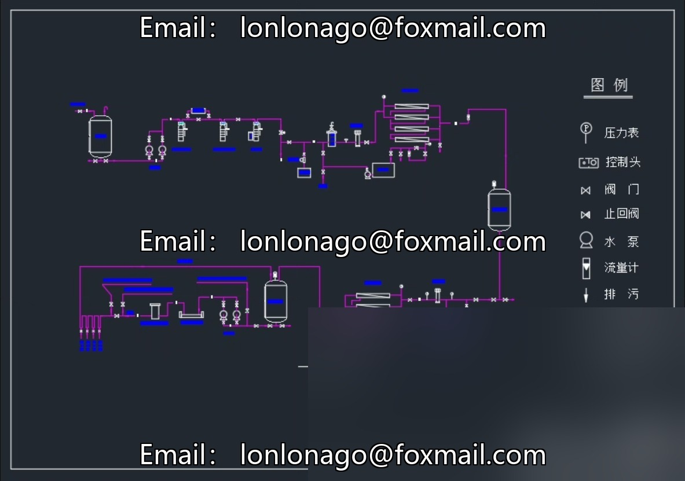
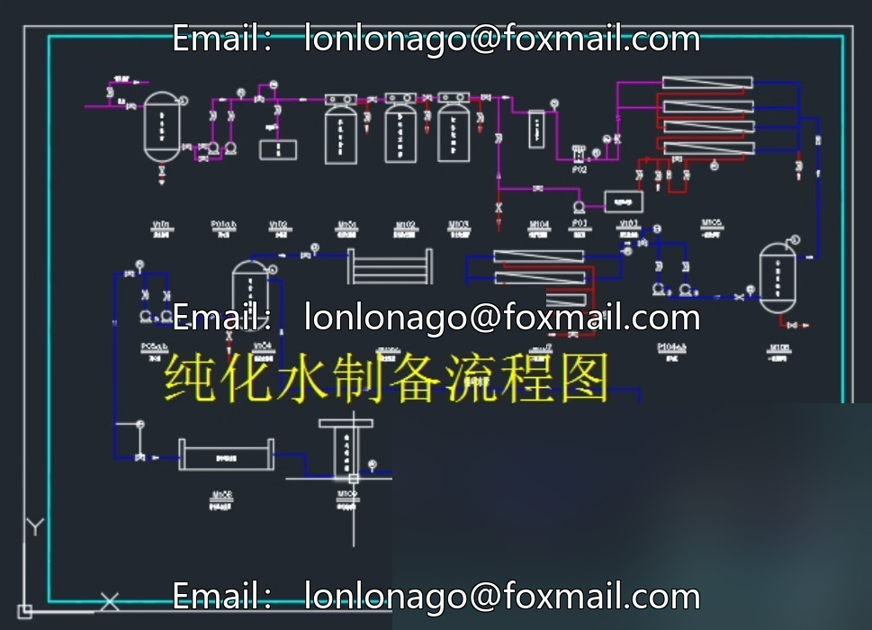

# Purified water preparation process diagram; purified water preparation process design; purified water preparation process flow diagram

## Body

Purity water preparation process diagram; purity water preparation process design; purity water preparation process flow diagram; purity water preparation process flow diagram
407    This design document is a "CAD booklet for purity water preparation process design"; purity water H2O is water obtained by distillation, ion exchange, reverse osmosis or other suitable methods from drinking water, without any additives. This design document provides several commonly used purity water preparation process flows, which are simple and reasonable, with good economic benefits, and see the details in the drawings for specific details.

This material provides purification water process diagrams, process design and process flowcharts, covering components such as pressure gauges, control heads, check valves, flow meters.

<!-- AI_ENRICHED -->

## Images

## Payment

Here is a pay link on Stripe ( https://buy.stripe.com/3cs8yP7sY87d0vu9AB ). Please contact me lonlonago@foxmail.com after funding $89, and I will send you a complete data files , thank you!

